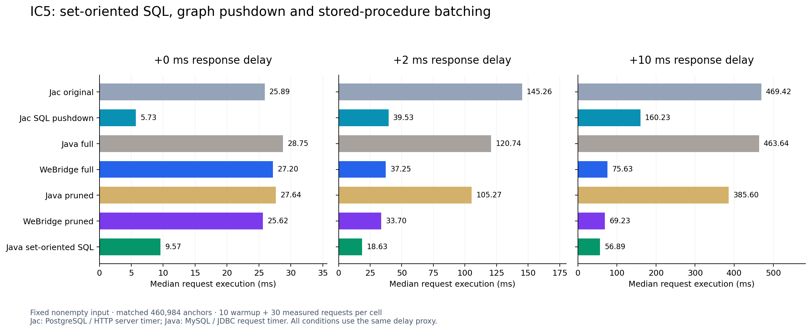

# IC5: conventional Java SQL, Jac and WeBridge under database latency

The conventional Java baseline executes the IC5 traversal as one set-oriented SQL statement. On the fixed small nonempty input it takes 9.57 ms with no added delay, 18.63 ms with 2 ms injected response delay and 56.89 ms with 10 ms. Jac SQL pushdown takes 5.73, 39.53 and 160.23 ms respectively. WeBridge's full-behavior procedure takes 27.20, 37.25 and 75.63 ms.

## All implementations

Median request execution time, milliseconds. Each cell has ten warmup and thirty measured requests. The zero-delay column uses the same forwarding path as the delayed columns.

| Implementation | 0 ms | +2 ms | +10 ms | Warm SQL commands |
|---|---:|---:|---:|---:|
| Jac original | 25.89 | 145.26 | 469.42 | 38 |
| Jac SQL pushdown | 5.73 | 39.53 | 160.23 | 14 |
| Java full | 28.75 | 120.74 | 463.64 | 38 |
| WeBridge full | 27.20 | 37.25 | 75.63 | 4 |
| Java pruned | 27.64 | 105.27 | 385.60 | 31 |
| WeBridge pruned | 25.62 | 33.70 | 69.23 | 4 |
| Java set-oriented SQL | 9.57 | 18.63 | 56.89 | 4 |

The Java full baseline reproduces Jac's original database access behavior. Java pruned removes the declared identity, ACL, schema and full-anchor hydration overhead. Their WeBridge variants execute the captured operation sequence through a generated stored procedure. The new Java set-oriented SQL baseline explicitly expresses JOIN, filtering, aggregation, ordering and LIMIT in one business query. Its four commands comprise transaction start, session setting, the business SELECT and commit.

[PDF chart](comparison.pdf) · [Machine-readable verified results](comparison.json) · [Measurement protocol](PROTOCOL.md)

## Correctness and query evidence

All 840 timing and warmup responses pass independent expected-result checks. The new SQL implementation also passes the original twenty input oracles plus the selected small-input oracle, with an independent server Questions delta of four for every input. `analyze.py` and `combine.py` recompute medians and verify request counts and results from raw rows. The original20-input collection remains distinct from the small-input latency workload.

The Java SQL is [ic5.sql](../alignment/idiomatic/ic5.sql); [IdiomaticIc5.java](../alignment/idiomatic/IdiomaticIc5.java) wraps that query and measures the complete request. Its fixture checks establish directed edges, the exercised type hierarchy, unique forum external IDs and at most one distinct valid Person creator per Post. Its set operations handle repeated friend, membership, container and same-creator edges. All twenty-one result gates pass. Saved small/original-input EXPLAIN plans and SQL provenance are under [the idiomatic baseline directory](../alignment/idiomatic/).

The native Jac SQL trace confirms a member-driven post-count aggregation plus database-side ordering and LIMIT. Its warm command count is fourteen, compared with thirty-eight for original Jac. Instrumented 10 ms runs retain the same counts and correct results. WeBridge issues four client commands while retaining the captured business operations inside the procedure. These are measured execution mechanisms with different database-work and communication costs.

## Actual round-trip calibration

| Database/client calibration | 0 ms setting | 2 ms setting | 10 ms setting |
|---|---:|---:|---:|
| PostgreSQL SELECT 1, before Jac arms |0.119 ms|2.202 ms|10.656 ms|
| MySQL SELECT 1, before full/pruned arms |0.250 ms|2.335 ms|10.894 ms|
| MySQL SELECT 1, before conventional SQL |0.264 ms|2.439 ms|10.894 ms|

These are persistent-connection round-trip medians after warmup. Response bytes receive the declared delay; database processing, driver and scheduler costs contribute to the observed RTT. SQL count is distinct from database protocol flight count. Raw samples and p95 values are retained; for example the 2 ms Jac baseline median/p95 are 145.26/199.45 ms, and pushdown 39.53/67.57 ms.

PostgreSQL and MySQL use different engines and runtime stacks. Jac additionally uses its derived mirror and adjacency structures; conventional Java SQL operates over the MySQL generic anchor representation. The same-Jac, same-Java and same-WeBridge delay comparisons keep their implementation and fixture fixed. Cross-system absolute times describe these complete implementations.

## Result interpretation

On this input, Jac SQL pushdown has the lowest no-added-delay latency. At the two injected delays, the new conventional Java SQL baseline has the lowest measured median. WeBridge's full behavior improves over the corresponding Java traversal by 1.06x, 3.24x and 6.13x across the three settings; Jac pushdown improves over original Jac by 4.52x, 3.67x and 2.93x. This separates the observed benefits of set-oriented query execution and reducing client/server exchanges.

The previous direct-transport local results are retained in the parent report. The delay sweep adds an identical proxy path to all three settings; its zero-delay measurements therefore form the reference for this table.

## Reproduction and cleanup

- `prepare_java.py`: compiles an endpoint-configurable copy of the existing Java timing driver; source hashes identify the sole endpoint adaptation.
- `java_sweep.py`: runs full/pruned Java and actual WeBridge at all three delays, with calibration and automatic proxy cleanup.
- `../jac-comparison/latency/sweep.py`: native Jac runs, SQL censuses, calibration and service cleanup.
- `../alignment/idiomatic/`: SQL implementation, twenty-one correctness gates, timing sweep, calibration, plans and provenance.
- `analyze.py`, `combine.py`, `render.py`: independent verification, combined table and PDF/PNG generation.

All delay proxies and benchmark application services stopped. Database statement-log settings were restored; the graph fixtures remain available. Cleanup receipts are stored beside each run. The [proxy audit](../jac-comparison/latency/PROXY_AUDIT.md) records forwarding behavior and observed traffic bounds.
